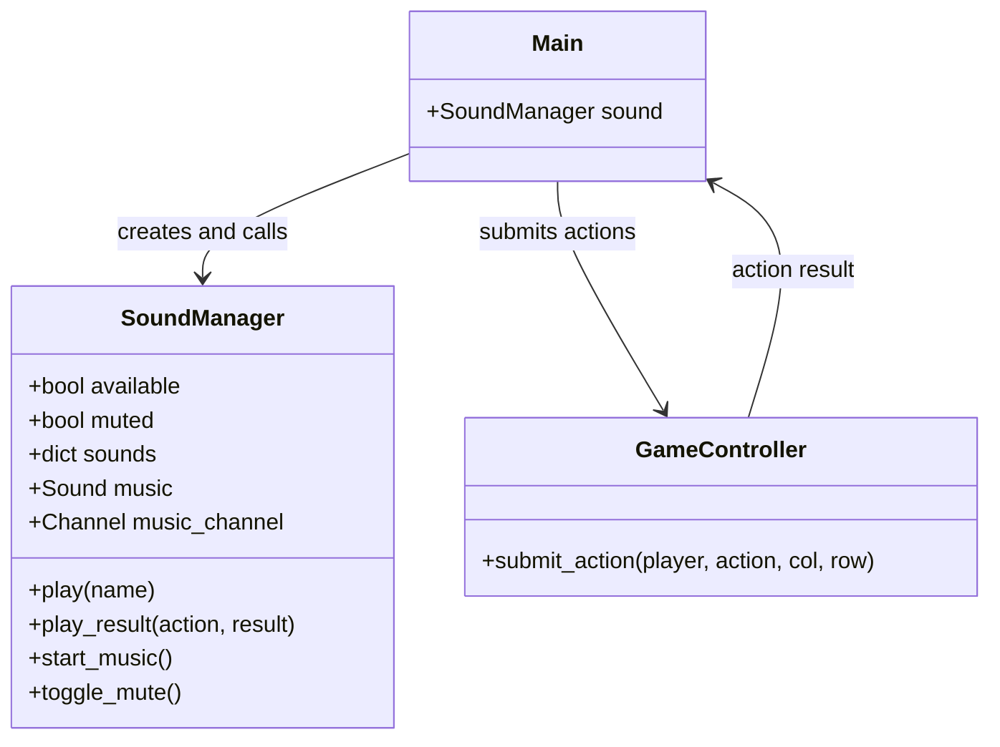
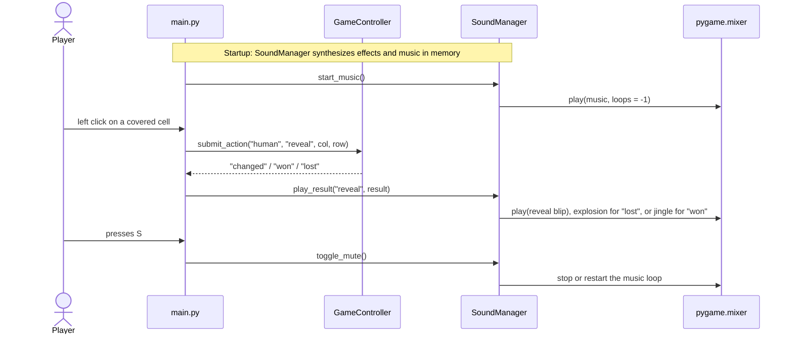

# Custom Feature: Sound Effects and Background Music

This document describes the custom addition for Project 2: an in-code sound system for the Minesweeper game.

## Feature description

- A short sound plays for every gameplay action:
  - **Reveal** a cell: a quick blip.
  - **Flag** placement: a higher tick.
  - **Mine hit**: an explosion burst (also plays when the computer loses).
  - **Win**: an ascending four-note jingle.
- A looping background melody starts when a game starts.
- Press **S** during a game to toggle sound on/off; the music pauses while muted.
- All sounds are **synthesized in code at startup** (square/sine waves and noise): no audio files to download or license, and no new dependencies.
- If the machine has no audio device, the game runs silently instead of crashing (`SoundManager.available` stays `False`).

## Where it lives

| File | Role |
| --- | --- |
| `sound.py` | `SoundManager` plus synthesis helpers (`_tone`, `_explosion`, `_jingle`, `_music`) |
| `main.py` | Creates the manager, calls `sound.play_result(action, result)` after each human/computer action, and `sound.toggle_mute()` on `S` |

## UML

### Class diagram

### Sequence diagram (one reveal, plus the mute toggle)

## Why this design

- No audio files means nothing to source or license; everything is generated from math at startup using only the Python standard library and `pygame.mixer`.
- `SoundManager` keeps audio details out of the game logic; `main.py` only reports action results.
- Graceful degradation keeps the game stable during stress testing even with no audio device.

## Attribution

- Sound synthesis and integration written by Rijul Poudel with AI assistance (Hermes Agent, Nous Research), October 2026.
- References: pygame documentation (`pygame.mixer`); Python standard library documentation (`array`, `math`, `random`).

## How to extend

- Add a new effect: add one entry to `_buffers()` and play it from `play_result` or directly from `main.py`.
- Tune loudness: change the `volume` argument of the synthesis helpers.
- Possible next steps: distinct tones for unflagging, or a different blip when the computer moves.
