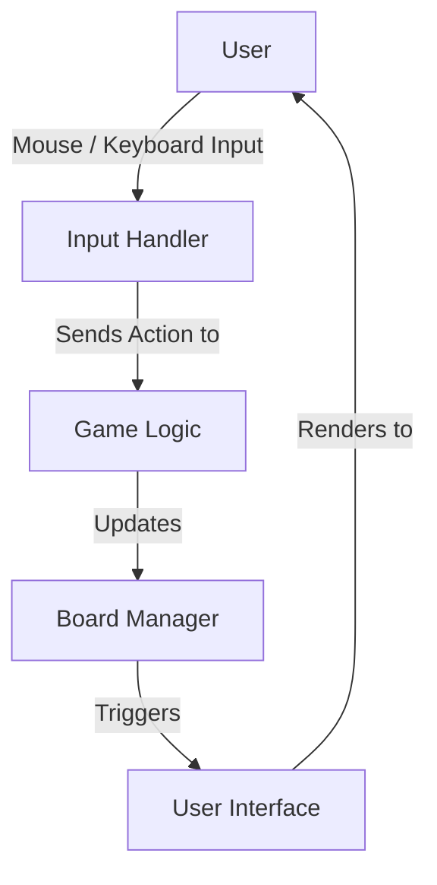
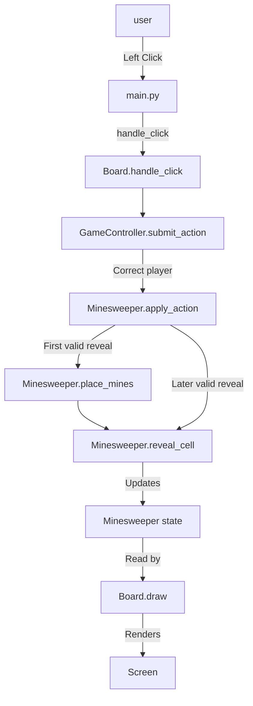
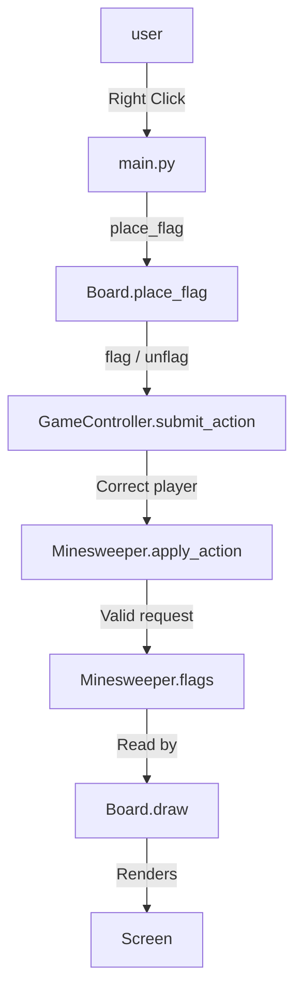
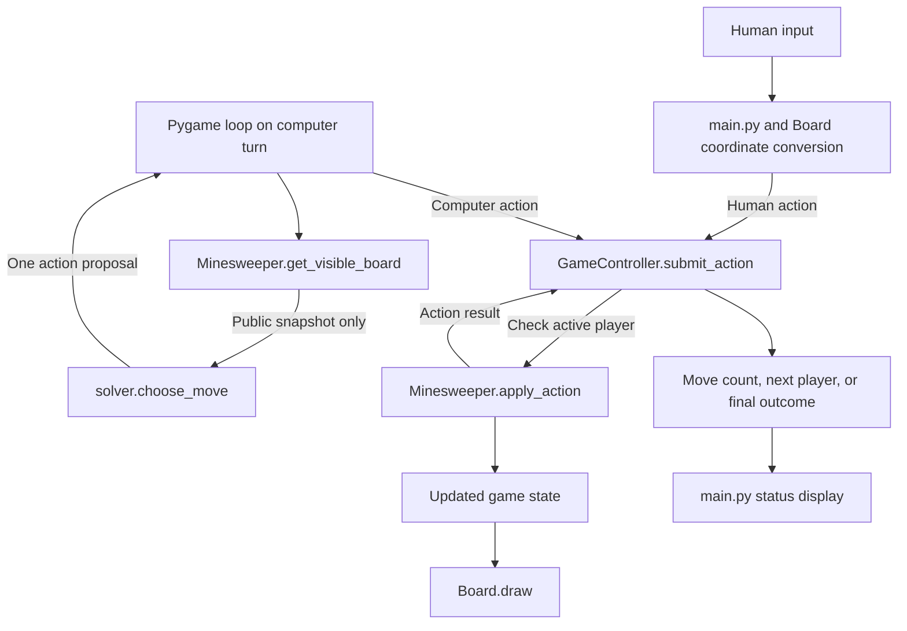

# System Architecture
This document describes the system architecture of Group 17's minesweeper game. It is intended for both the GTA and the Project 2 team.

[Link back to README](../README.md)

## Overview
This project is a 10x10 version of the puzzle game Minesweeper. It has user specified number of mines (10-20), the first click is guaranteed to be safe, the user can toggle flags, and the game automatically detects a win/loss.

The default mode is `single_player`, with optional Easy/Medium/Hard AI assistance.
`T` starts alternating `human_vs_ai` play through the shared action interface.
The controller also supports `ai_only` programmatically. The [timer design](Timer.md)
describes elapsed-time tracking and includes its UML sequence diagram.

## File Layout
The files are laid out as follows:
```
.
├── README.md
├── documentation
│   ├── SystemArchitecture.md
│   ├── Timer.md
│   ├── CustomFeature_Sound.md
│   ├── person-hours.md
│   └── Team17_meeting_log.pdf
└── minesweeper
    ├── assets
    ├── ai_solver.py
    ├── board.py
    ├── controller.py
    ├── main.py
    ├── minesweeper.py
    ├── solver.py
    ├── sound.py
    ├── timer.py
    └── tests
```

- `assets` folder contains the font and pngs for each cell state.
- `documentation` folder (repository root) contains the system architecture, feature documentation, and person-hours records.
- `README.md` file is the readme.
- Python bytecode caches are generated locally and excluded by `.gitignore`.

## Components


- Board Manager: Implemented by `Board` and `Minesweeper`
  - `Board` does the geometry and rendering
  - `Minesweeper` does the cell state
- Game Logic: Implemented by `Minesweeper`
- User Interface: Implemented by `Board.draw`, `draw_input_screen`, and the drawing code in `main.py`
- Input Handler: Implemented by `main.py` event loop, `Board.handle_click`, and `Board.place_flag`
- Sound: Implemented by `SoundManager` in `sound.py` (custom feature); `main.py` reports each action result to it

## Code Structure

The main code files are:

- main.py: depends on `pygame`, `board.py`, `controller.py`, `solver.py`, `ai_solver.py`, and `timer.py`

- board.py: depends on `pygame` and `controller.py`

- minesweeper.py: depends on `random`

- controller.py: depends on `minesweeper.py`; manages turns and outcomes independently of Pygame

- solver.py: depends on `random`; chooses actions from a visible-board snapshot and public mine total

- sound.py: depends on `pygame`, `array`, `math`, and `random`; synthesizes and plays the sound effects and the background music loop (custom feature)

### main.py
- Entry point of the program
  - Initializes Pygame with a 650x650 window
  - Sets the font
- Runs the input screen to select a valid mine count from 10 to 20; starts in single-player
- Creates a `GameController` and passes it to `Board`
- Then it enters the main loop
- The main loop handles the QUIT and `handle_click` events
  - QUIT event exits the loop
  - `handle_click` events calls either `handle_click()` or `place_flag()` method for left click and right click respectively
- Automatic AI actions run at most once per update with a 300 ms delay. Events and drawing continue between moves.
- The procedural structure uses `draw_input_screen()` and a setup loop followed by the gameplay loop.
- The loop draws the board, outcome or active player, controls, selected AI, and the timer when single-player assistance is off.
- `E`/`M` selects Easy/Medium assistance using `AISolver` on the existing single-player board; `Space` steps and `A` toggles autoplay. This helper directly updates the model and does not consume controller turns.
- `T` starts fresh alternating play using `solver.choose_move` and controller submissions. `R` resets the current mode. `Esc` disables single-player assistance on the same board, or starts a fresh single-player board when leaving alternating play. Solver exhaustion or errors pause alternating computer play with a restart message.
- `GameTimer` observes state after each event and automatic move. It starts on the first reveal by either player, tracks time even while hidden, freezes at game over, and resets with the board.
- Outside the loop, `pygame.quit()` is called to exit


### board.py
- Defines the `Board` class
- Methods:
  - `__init__(self, controller)`
    - Sets the tile size to 50
    - Sets the font
    - Stores the controller and loads assets once from `assets/...`; launch from the `minesweeper` folder
    - The `game`, `rows`, and `cols` properties read the current controller game, including after a reset
  - `handle_click(self, mouse_x, mouse_y)`
    - Converts mouse position to tile coordinate (ignoring clicks not on the board)
    - Calls `controller.submit_action("human", "reveal", col, row)` and returns the action result
    - The controller checks the turn; the model validates the cell before placing mines or revealing cells
  - `place_flag(self, mouse_x, mouse_y)`
    - Converts mouse position to tile coordinate
    - Translates the human toggle into `flag` or `unflag`, then calls `controller.submit_action()` as the human
    - The model validates the request and changes the flag state
  - `loadAssets(self)`
    - Loads and resizes numbered tiles and event sprites from the `assets` folder

  - `draw(self, screen)`
    - Draws the column labels A-J
    - Draws the row labels 1-10
    - Draws the sprites depending on the state (ie draws "explosion" sprite if a mine was exploded)
    - Draws the number of adjacent mines
    - Footer counts and turn information are drawn by the loop in `main.py`

### minesweeper.py
- Defines the `Minesweeper` class which is in charge of the core game logic
- Methods:
  - `__init__(self, num_mines, rows, cols)`
    - Creates sets for `self.mines`, `self.revealed`, and `self.flags`
    - Sets `self.first_click` to `True`
    - Sets `self.adjacent_mines` to a a dictionary to track adjacent mines in each cell
    - Sets `self.game_over` and `self.won` to `False`
    - Sets `self.exploded_mine` to `None`
  - `place_mines(self, safe_col, safe_row)`
    - Creates a 3x3 zone centered on the first click
    - Calls `self.calculate_adjacent`
  - `calculate_adjacent(self)`
    - Iterates over all cells
    - Skips calculation if cell is a mine
    - Counts mines in a 3x3 area around the cell and adds result to the `self.adjacent_mines` dictionary
  - `reveal_cell(self, col, row)`
    - Returns `True` if the cell is not a mine, `False` if cell is a mine
    - If cell is a mine: marks the cell in `self.exploded_mine` and sets `self.game_over` to `True`
    - Skips over flagged and already revealed cells
    - If adjacent count is 0, recursively reveals neighbor cells
    - Sets `self.won` to `True` if all safe cells are revealed
  - `apply_action(self, action, col, row)`
    - Validates and applies a `reveal`, `flag`, or `unflag` request
    - Returns `no_change`, `changed`, `won`, or `lost`
    - Initializes mines only on the first valid reveal and reuses `reveal_cell()` for expansion
  - `get_visible_board(self)`
    - Returns a fresh matrix of revealed numbers, `"flagged"`, and `"covered"`
    - Hides mine locations from the solver, including after game over

## Data Structures
- In class `Minesweeper`:
  - `self.mines`: set of `(col, row)` tuples for mine locations
  - `self.revealed`: set of `(col, row)` tuples for revealed safe cells
  - `self.flags`: set of `(col, row)` tuples for flagged cells
  - `self.adjacent_mines`: dictionary that maps `(col, row)` tuples to an integer (0-8)
  - `self.first_click`, `self.game_over`, `self.won`: booleans
  - `self.exploded_mine`: location of exploded mind `(col, row)` tuple or `None`
- In class `Board`:
  - `self.tiles`: dictionary that maps integers 1-8 to the Pygame tile surfaces (numbers 1-8)
  - `self.events`: dictionary that maps event names to Pygame surfaces (eg a picture of a mine)
    - Event names: `unknown`, `empty`, `flag`, `mine`, `explosion`

## Data Flow
- Input screen:
  1. `main.py` shows the input screen and validates that the user input is an int 10-20
  2. `main.py` creates a controller for the selected mode and a `Board` that reads that controller
- Left click:
  1. User left clicks
  2. Pygame generates an event
  3. `main.py` calls `board.handle_click(x, y)`
  4. `Board` converts the mouse position to `(col, row)` and calls `controller.submit_action("human", "reveal", col, row)`; the controller validates turn ownership before calling the model
  5. `Minesweeper` validates the request, places mines on the first valid reveal, and calls `reveal_cell()` to update its state
  6. `main.py` calls `board.draw(screen)` and `Board` reads `Minesweeper` state and renders
  7. `main.py` draws the status text and calls `pygame.display.flip()`
- Right click:
  1. User right clicks
  2. `main.py` calls `board.place_flag(x, y)`
  3. `Board` converts the coordinates and submits `flag` or `unflag` through `controller.submit_action()` as the human
  4. `Board.draw` renders the updated flag

## Sequence Diagrams

### Left Click / Uncover


### Right Click / Flag

## AI solver architecture

This section describes the controller turn modes. Alternating play routes both players through `GameController`; optional single-player `AISolver` assistance directly updates the model.

### Component responsibilities

| Component | Responsibility | Status |
| --- | --- | --- |
| `Minesweeper` in `minesweeper.py` | Own cell state, validate actions, protect the first reveal, expand empty cells, detect terminal results, and produce visible snapshots | Implemented |
| `GameController` in `controller.py` | Own mode, active player, winner, move count, action submission, and game reset | Supports three modes |
| `Board` in `board.py` | Convert mouse positions to cell coordinates and render model state | Human actions use the controller |
| `main.py` | Process events, select a mode, schedule computer actions, and display turns and outcomes | Implemented |
| `solver.py` | Choose one action using the visible-board snapshot and public mine total | Implemented |
| `GameTimer` in `timer.py` | Track elapsed time from first reveal through game over | Displayed in single-player without assistance |
| `AISolver` in `ai_solver.py` | Easy/Medium assistance on the current single-player model | Steps or autoplay |

The runtime flow is:



### Modes and turn rules

| Mode | Session behavior | UI control |
| --- | --- | --- |
| `single_player` | Human keeps every turn; optional Easy/Medium assistance; timer shown with assistance off | Default; Esc disables assistance or leaves alternating play |
| `human_vs_ai` | Human starts; successful actions alternate with the computer | T starts a fresh game |
| `ai_only` | Computer takes every action | Controller API only |

`human_vs_ai` shares one board between the human and computer. The human starts, and successful actions alternate between players. In `ai_only`, the human starts the session and the computer takes every gameplay action.

`single_player` keeps the human active after successful actions. Invalid actions
do not count as moves; a win records the human, and a loss leaves no winner.
Optional `AISolver` assistance updates the model directly; controller move counts
and winner attribution therefore describe controller-submitted actions only.
The elapsed timer observes model state regardless of who reveals a cell.

| Event | Human vs. computer | Computer-only |
| --- | --- | --- |
| First active player | Human | Computer |
| Successful nonterminal reveal, flag placement, or flag removal | Count one move and switch players | Count one move; computer continues |
| Invalid action or action that changes nothing | Keep the same player; do not count a move | Do not count a move; choose another action |
| Empty-cell expansion | Part of the original reveal; consumes no extra turns | Part of the original reveal; consumes no extra moves |
| Mine hit | Acting player loses; opponent wins | Computer loses |
| Last safe cell revealed | Acting player wins | Computer wins |
| Game over | Reject further actions | Reject further actions |

Resolve a win or loss before switching players or scheduling another computer action. Human board clicks are ignored during computer turns and throughout computer-only play. The controller enforces ownership for both mouse input and computer requests.

### Reveal and flag rules

- The first successful reveal and all of its in-bounds neighbors contain no mines. Flag operations and rejected reveals do not consume this protection.
- Flags are shared markers. A flag can be incorrect and is not proof of a mine. Placing all available flags does not win the game.
- A reveal cannot target a flagged cell. A revealed cell cannot receive a flag, and the total number of flags cannot exceed the mine count.
- Human right-click toggles a flag by submitting `flag` when absent or `unflag` when present.
- The solver's `flag` action only places a flag. Repeating it on a flagged cell returns `no_change`; it never removes the flag.
- Removing a flag requires an explicit `unflag` action. Removing a flag that is absent returns `no_change`.

### Shared action interface

Both players submit `controller.submit_action(player, action, col, row)`. Player values are `"human"` and `"computer"`; action values are `"reveal"`, `"flag"`, and `"unflag"`. Coordinates are zero-based `(col, row)`, matching the model's methods.

The controller checks game-over state and player ownership before calling `game.apply_action(action, col, row)`. The model validates the action name, integer coordinates, bounds, game-over state, and cell eligibility before changing state or placing mines. Boolean coordinates are invalid. Rejected actions preserve the model state.

| Model result | Controller response |
| --- | --- |
| `no_change` | Keep the active player and move count |
| `changed` | Increment the move count; switch players only in `human_vs_ai` |
| `won` | Increment the move count, record the acting player as winner, and stop play |
| `lost` | Increment the move count, record the opponent as winner in `human_vs_ai`, and stop play |

`apply_action()` reuses `reveal_cell()` internally. The latter returns a boolean that does not distinguish a successful reveal from a no-op, so callers use the explicit action result to decide whether a turn was consumed. Recursive expansion never switches turns.

### Visible-board contract

`game.get_visible_board()` returns a fresh matrix indexed by `[row][col]`. The solver must convert that indexing into `(col, row)` when returning a move.

| Cell value | Meaning |
| --- | --- |
| Integer `0` through `8` | Revealed cell with that many adjacent mines |
| `"flagged"` | Flagged cell, whether or not the flag is correct |
| `"covered"` | Any other hidden cell, whether safe or mined |

Snapshot generation reads `adjacent_mines` only for revealed cells. Editing a returned matrix cannot change the game. This contract continues to hide mines after game over, even when the renderer displays them.

The solver receives this snapshot and the public mine total, never the game object, mine locations, or the full adjacency dictionary. Rendering may read the model's hidden state for the end-of-game display, but that state must not enter the solver input.

### Solver decisions and event-loop integration

The entry point is `choose_move(visible_board, num_mines, *, rng=None, rejected_moves=())`, returning one `(action, col, row)` request or `None`. The solver propagates facts from revealed clues and the public mine total. It prefers safe reveals, then removal of proved-wrong flags, then placement of proved mines within the flag limit.

Flags are unknown cells until clues prove their contents. When deduction stalls, the solver guesses uniformly among covered cells not proved mined. If only uncertain flags remain available, it removes one. It returns `None` when no candidate remains. The solver is not guaranteed to win or play optimally.

Alternating play pauses on `None`, a solver `ValueError`, or a rejected request.
Rejected actions do not count as moves. Restart or a new mode clears pause state.
The solver API accepts exclusions for other callers, but this event loop pauses
on rejection instead of retrying. Regression tests exercise the timer and real
Pygame event loop with deterministic ticks, events, and seeded gameplay.

For each computer move, the Pygame loop:

1. Check that the game is active and `active_player` is `"computer"`.
2. Obtain a fresh visible-board snapshot and ask the solver for one action.
3. Submit the proposal through `GameController` as `"computer"`.
4. Process the result and display the active player or final outcome before scheduling another move.
5. Continue processing events and drawing between moves. Use a timer for any visible delay, rather than a blocking solve loop.

Human input uses the same controller path after mouse-coordinate conversion. `Board.game` reads `controller.game` so the rendered board matches the state used to resolve actions, including after a reset.

### Controller state and reset

| Field | Meaning |
| --- | --- |
| `game` | The `Minesweeper` instance for the current session |
| `mode` | `"single_player"`, `"human_vs_ai"`, or `"ai_only"` |
| `active_player` | `"human"` or `"computer"` during play; `None` after a win or loss |
| `winner` | Winning player; `None` before the outcome or after a computer-only loss |
| `move_count` | Successful actions, including the terminal action; excludes rejected actions |

Player identity is separate from `game.won`, which records whether all safe cells were revealed. A computer-only loss has `winner = None` and `game.game_over = True`.

`controller.new_game()` preserves the current mode, dimensions, and mine count. Passing `"single_player"`, `"human_vs_ai"`, or `"ai_only"` selects a new mode. Reset clears the winner and move count, selects the first player for that mode, and creates a new `controller.game`. The board properties follow the new instance automatically; the app resets the timer, assistance, computer timing, and pause state.

```python
controller = GameController(num_mines=10, rows=10, cols=10, mode="human_vs_ai")
result = controller.submit_action("human", "reveal", 0, 0)
controller.new_game()  # Keep the current mode and board configuration.
controller.new_game("ai_only")  # Start a new board with the computer active.
```

### AI solver levels (`ai_solver.py`)

`AISolver(game, difficulty)` runs the selectable easy/medium/hard assist. `choose_action()` returns one move without touching state, `step()` applies it. It reads only visible information (revealed clues, covered/flagged status) and never inspects `game.mines`.

| Difficulty | Behavior |
| --- | --- |
| easy | Random reveal among covered, unflagged cells. |
| medium | Rule 1: when a clue's hidden neighbors equal its number, flag them. Rule 2: when a clue's flags equal its number, open its other hidden neighbors. Otherwise random. |
| hard | All medium rules plus the 1-2-1 pattern: three revealed clues reading 1-2-1 with a hidden row on the known side get their two outer cells flagged and their middle cell opened. Applied only when the opposite side is known, so it never guesses; otherwise it falls back to medium rules and random. |

Mode/difficulty routing in `main.py`: single-player assist uses `AISolver` (E/M/H keys, `Space` steps, `A` autoplays). `ai_only` and `human_vs_ai` (T) submit computer moves through `GameController.submit_action` every 300 ms: with a difficulty selected they use `AISolver.choose_action`, with none selected they use `solver.choose_move`.

## Custom Feature: Sound and Music

The rubric custom addition is this sound system (UML in [CustomFeature_Sound.md](CustomFeature_Sound.md)); the game timer ([Timer.md](Timer.md)) is a second, also documented enhancement.

Sound effects (reveal, flag, mine hit, win) and a looping background melody, synthesized in code and played through `pygame.mixer`. Press `S` to toggle sound. See [CustomFeature_Sound.md](CustomFeature_Sound.md) for the description and UML diagrams.

## Asset Attributes

- Numbered Tiles and Sprites
https://uchimama.itch.io/minesweeper-tileset
*Credit: UchiMama via itch.io*

- Pixelated Font
https://tinyworlds.itch.io/free-pixel-font-thaleah
*Credit: Rick Hoppman via itch.io, licensed for commercial use.*

*Disclaimer: All visual assets used in this project marked as free on itch.io. Authors of
the assets are credited above.*

## Person Hours

#### Drew Franke
| Task                                  | Estimated | Actual |
| ------------------------------------- | --------- | ------ |
| Coding and Pygame Documentation       |    1      | 1.5    |
| Coding Task 2 and Left-Click Handling |    1.5    | 1.5    |
| **Total**                             |  **2.5**  | **3**  |
#### Vrishank Kulkarni
| Task            | Estimated | Actual |
| --------------- | --------- | ------ |
| Flagging System (task 5) |     1      | 1.5      |
| **Total**       |      **1**     | **1.5**  |
#### Alex Lanter
| Task                                | Estimated | Actual   |
| ----------------------------------- | --------- | -------- |
| Adjacent Mines and Recursive Reveal |      1     | 1.5      |
| Win/Lose Logic (Merge Integration)                      |      .5     | .75      |
| **Total**                           |      **1.5**     | **2.25** |
#### Mo Osby, Kayaan Patel
| Task           | Estimated | Actual  |
| -------------- | --------- | ------- |
| Win/Lose Logic |     1      | 2      |
| **Total**      |     **1**      | **2** |
#### Davina Love
| Task                   | Estimated | Actual  |
| ---------------------- | --------- | ------- |
| Coding UI              | 2         | 2.0     |
| Asset Files            | .5        | 1.0     |
| Flagging System & misc | 1.0       | 1.5     |
| **Total**              | **3.5**   | **4.5** |
#### Noah Mast
| Task           | Estimated | Actual  |
| -------------- | --------- | ------- |
| Documentation  |     3.5      | 5      |
| **Total**      |     **3.5**      | **5** |
#### How we got our estimates: 
We convened as a group, and each of us gave our estimates in hours for the tasks we were assigned and those others were assigned. 
We then took the average of hours for each task. We believe we underestimated because several group members are new to Pygame and despite knowing how to implement things, we had to learn the syntax.

#### Group Meetings : 4 hours, 4 meetings
#### Group Meeting Estimate : 3 hours, 3 meetings


## Grand Total Person Hours 
### Estimated = 16
### Actual = 22.25
