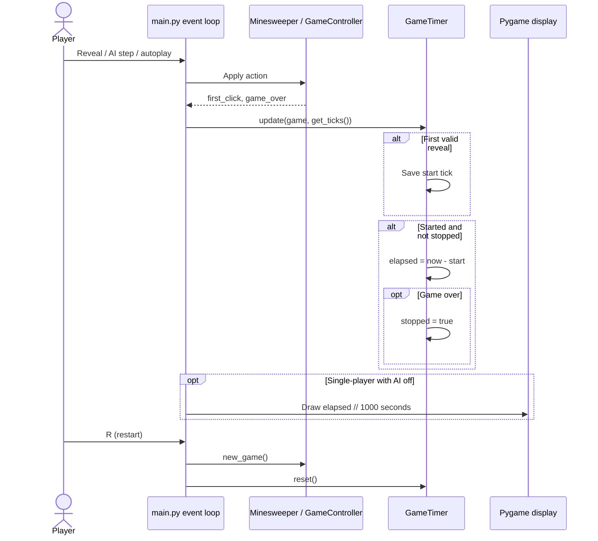

# Game timer

Maintained by Kodai Nakae, 10/10/2026. OpenAI Codex assisted the review fixes
and documentation.

The timer measures elapsed wall-clock gameplay time in milliseconds using
`pygame.time.get_ticks()` and displays whole seconds. A fresh game shows `Time: 0s`.
The first valid reveal starts the timer, whether performed by the human,
an AI step, or autoplay. Flags, invalid clicks, and AI difficulty selection do
not start it. The first observed win or loss freezes the value.

The timer is visible only in `single_player` with AI assistance off. Selecting
E/M hides the display while elapsed time continues; Esc restores it without
starting a new timer or erasing time spent with assistance. Thus this is session
time, not a record certified as unaided play. R resets both board and timer.
T starts a fresh alternating game, and Esc from alternating play starts a fresh
single-player game. Both transitions reset the timer.

`GameTimer` has `start` (milliseconds or `None`), `elapsed` (milliseconds), and
`stopped` (boolean). It receives game state and the current monotonic tick count;
it does not import Pygame or change gameplay state. The event loop updates it
after every event and after automatic AI execution, including the terminal move.

## UML sequence diagram

## Verification

From the repository root, run `python -m unittest discover -s minesweeper/tests`.
Tests cover flags and invalid clicks, human and AI first reveals, hidden timer
updates, terminal results, and reset. Pygame is required for the event-loop tests.
